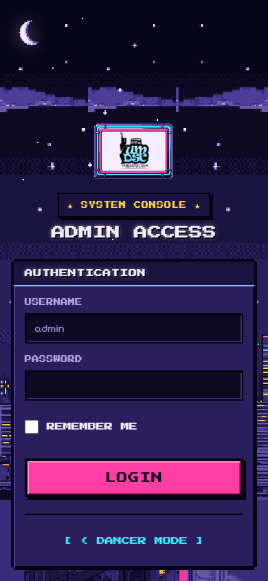
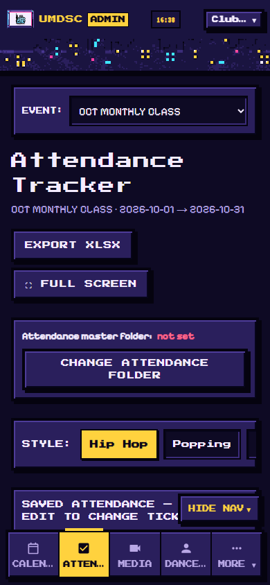
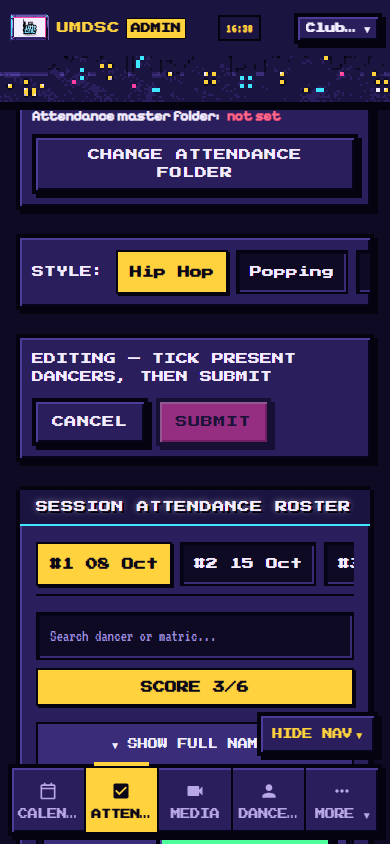
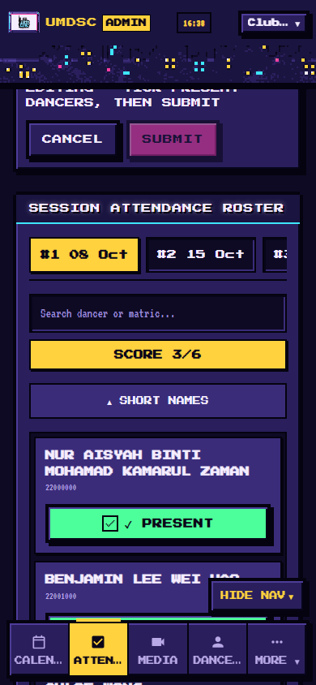
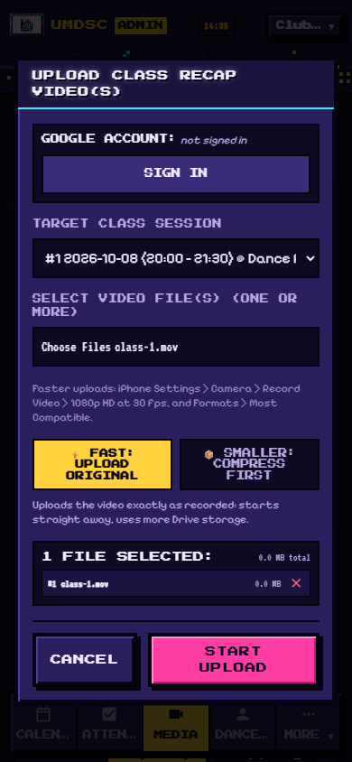

# Class Lead & Class Rep Guide

**For:** Class Leads and Class Reps who take attendance, manage walk-in dancers, and upload class recap videos and music.  
**Website:** [https://umdsc-dance-class.umdancesportc.workers.dev](https://umdsc-dance-class.umdancesportc.workers.dev)  
**Works on:** Mobile phones and computers. Authorizing Google Drive folders is recommended on a computer (marked 💻).  

---

## 1. Before your first class

Your club administrator provides you with your login credentials and setup:

1. **A website account:** a **Username** and **Password** created under the built-in **Class Rep (`class_rep`)** or **Admin** role.
2. **Assigned Dance Styles:** Your account may be scoped to your specific dance style(s) (e.g. *Locking* or *Hip Hop*). The website automatically hides administrative tabs you do not need, keeping your interface clean.
3. **Google Sign-In access:** Your Gmail address must be added to the Google Cloud OAuth test user list so Google allows your Drive uploads.
4. **Google Drive folder link:** Create a folder in your personal Google Drive (e.g., *Locking Class Videos 2026*), then **share it with `umdancesportc@gmail.com` as Editor**. Send the link to the admin to register under your dance style.

> 💡 Recap videos are stored directly in **your** personal Google Drive folder and use **your** Drive storage quota.

---

## 2. Logging in

1. Navigate to the admin login page:  
   [https://umdsc-dance-class.umdancesportc.workers.dev/admin/login](https://umdsc-dance-class.umdancesportc.workers.dev/admin/login)
2. Enter your **Username** and **Password**, then click or tap **LOGIN**.

### Navigation bar
- **On phone:** Navigation is located at the bottom: **Calendar · Attendance · Media · Library · Dancers · More**.
- **Dynamic permission hiding:** If your role is **Class Rep**, tabs requiring elevated privileges (such as *System Settings* or *Admin Accounts*) are hidden automatically.
- To maximize screen space on mobile, tap **HIDE NAV**; tap **SHOW NAV** to restore it.

---

## 3. Taking attendance

1. Tap **Attendance** from the navigation bar.
2. Check the **EVENT** selector at the top (e.g. *NOV MONTHLY CLASS*).
3. Select your assigned **STYLE** (e.g. *Locking*).
4. Tap the **class session** you are running (e.g. **#3 18 Nov**).

5. Tap **EDIT** to begin taking attendance.
6. For each dancer who attended:
   - Tap **ABSENT**: the button turns vibrant green and displays **✓ PRESENT**. Tap again if you need to revert.
   - The **SCORE** counter updates in real time showing the number of attendees present.
   - Use the **Search dancer or matric…** search bar to quickly filter by dancer name or student ID.
   - If long student names are truncated on a narrow phone screen, tap **▼ SHOW FULL NAMES**. The app remembers your preference.
7. Tap **SUBMIT** to save all attendance marks to the database.

### Important attendance tips
- **Unsaved changes warning:** If you attempt to navigate away before pressing **SUBMIT**, the browser prompts you to confirm so you don't lose ticks.
- **Offline resilience:** If your mobile data or Wi-Fi drops while saving, ticks are queued in browser memory and flushed automatically once connectivity returns. A screen wake lock prevents your phone from sleeping during submission.
- **Multi-device sync:** Multiple leads can take attendance simultaneously; updates sync across devices within approximately 20 seconds.
- **Excel & Google Sheets export:** Tap **EXPORT XLSX** to download a formatted spreadsheet, or click the sheet link to view the live master sheet in Google Drive.

---

## 4. Walk-In dancers & guest access

Dancers who did not register through the monthly Google Form can still attend as walk-ins:

1. In **Calendar** (or editing the class session in **Classes**), look for the **Walk-In Class Code** (e.g. `LCK-7X9`).
2. Share this code with the guest dancer or let them copy it.
3. The guest dancer opens the site login screen, switches to **⚡ WALK-IN PASS**, enters the code and their name, and gains instant access to that session's videos and practice music.
4. On the attendance roster, walk-in dancers are labeled with a **WALK-IN PASS** badge. Administrators can later convert walk-in profiles to registered club members with full history.

---

## 5. One-time setup: Authorize your video folder 💻

Complete this setup **once** before uploading your first video. Using a computer browser is strongly recommended.

1. Log in and open **Media**.
2. Locate **CLASS LEAD VIDEO DRIVE FOLDERS** and tap **▼ EXPAND**.
3. Verify your **Google account:**:
   - If it shows your personal Gmail, proceed to the next step.
   - If it shows *not signed in* or another account, tap **SIGN IN** or **SWITCH ACCOUNT** and choose your Gmail.
4. On your dance style's row, tap **AUTHORIZE**.
5. Google will open a secure picker window displaying your pre-linked folder. Click the folder, then click **Select**.
6. The status row now shows **✓ AUTHORIZED** with **Uploads as** *your Gmail*.

---

## 6. Uploading class recap videos

1. Open **Media** and choose the **EVENT** and **STYLE**.
2. Select your class card, then tap **UPLOAD VIDEO** (or **+ ADD RECAP FOR CLASS #N**).
3. Verify your Google account email is selected under **Google account:**.
4. Ensure the **TARGET CLASS SESSION** is set to the correct class.
5. Tap **Choose Files** and select one or more video recordings from your device.
6. Select your upload speed mode:
   - **⚡ FAST: UPLOAD ORIGINAL:** Uploads the video without re-encoding, preserving full resolution. Best when on fast Wi-Fi. Automatically selected for clips under 150 MB.
   - **📦 SMALLER: COMPRESS FIRST:** Compresses the video client-side in the browser to 720p H.264 before uploading. Saves Google Drive storage and mobile data. Automatically selected for videos over 150 MB.
7. **Batch Email Notifications:** The **Notify dancers via email** checkbox is enabled by default. Once your upload completes, the system sends **one consolidated batch email** (`videos.notifyBatch`) summarizing all newly uploaded recap videos to the registered dancers, preventing notification spam.
8. Tap **START UPLOAD** and keep your screen on and browser tab active until the progress bar reaches 100%.

### Troubleshooting upload blocks

| Error message | Solution |
|---|---|
| *Class lead video folder link not inserted* | Contact an admin to enter your Google Drive folder link in Settings. |
| *…has no upload account yet* | Complete the one-time authorization in Section 5. |
| *…uploads with X, but you're signed in as Y* | Tap **SWITCH ACCOUNT** in the top bar and select account X. |
| *This class lead folder isn't authorized yet* | Open Media on a desktop computer and click **AUTHORIZE**. |

### Deleting a video
Click **DELETE** on the video card and confirm. The record is removed from the website and the video file in Google Drive is moved to **Trash** (retained for 30 days).

---

## 7. Adding music to the Shared Music Library

The system features a **Shared Music Library (`/library` and `/admin/library`)** where songs are categorized by **Dance Style** across the entire club. Tracks can be attached to a specific class or added as a general style practice song.

In **Media** (or via the **+ MUSIC LINK** / **UPLOAD MP3** buttons):

1. **Adding audio links (`+ MUSIC LINK`):**
   - Paste a link from **YouTube**, **Spotify**, **SoundCloud**, or a **Google Drive MP3**.
   - Set the **Track Title**.
   - In **Link to Session**, you can choose a specific class session **OR** select:
     `-- General Style / Event Library Track --`
     General tracks appear immediately in the Shared Music Library across all events for that style!
2. **Uploading local MP3s (`UPLOAD MP3`):**
   - Pick an `.mp3` file from your device.
   - Choose the target session or `-- General Style / Event Library Track --`.
   - The file is saved directly into your style's Google Drive music folder and registered in the library.
3. **Studio Shortcut (`▶ PLAY IN STUDIO`):**
   - In the **Library** tab (`/admin/library`), each playable track has a direct **▶ PLAY IN STUDIO** button that opens the interactive practice studio with that track preloaded.

### Practice sections (choreography loops)
Under any track in **Media**, tap **MANAGE SECTIONS** to configure loop markers:
- Add named sections such as *Verse 1*, *Chorus Routine*, or *Bridge Combo* with start and end timestamps.
- Dancers can loop these sections seamlessly in the **Music Studio**.

---

## 8. Class Lead quick checklist

- [ ] **Before class:** Check the class schedule and have your Walk-In Class Code (`LCK-7X9`) ready for guests.
- [ ] **During class:** Open **Attendance** → select style & class → tap **EDIT** → tick attendees → tap **SUBMIT**.
- [ ] **After class:** Open **Media** → tap **UPLOAD VIDEO** → upload recap clips (keep screen awake).
- [ ] **Music & Practice:** Add practice music links or upload MP3s, and configure loop sections for complex routines.
