# Admin Guide

**For:** Club executive committee members and system administrators.  
**Website:** [https://umdsc-dance-class.umdancesportc.workers.dev/admin/login](https://umdsc-dance-class.umdancesportc.workers.dev/admin/login)  
**Best experience:** Laptop or desktop computer. (All administration tools are mobile-responsive, but initial event setup and Google integration are fastest on a larger screen).  

Admins can perform all tasks available to class leads; refer to the **Class Lead Guide** for attendance taking and video uploading. This guide covers managing monthly events, Google Form auto-gating, dance styles, instructors, admin accounts, and system-wide settings.

---

## 1. Login and navigation layout

Log in at **/admin/login** with your **Username** and **Password**, then click **LOGIN**.

### Navigation structure
- Primary navigation tabs:
  1. **Calendar (`/admin/calendar`):** Monthly class schedules, session editor, and Walk-in codes.
  2. **Attendance (`/admin/attendance`):** Live attendance taking, Excel export, and Google Sheet links.
  3. **Media (`/admin/media`):** Drive folder authorization, hybrid video uploads, and music section editor.
  4. **Library (`/admin/library`):** Shared club music library across all styles with inline preview & Studio launch.
  5. **Dancers (`/admin/members`):** Registered dancer roster, search, player profile cards, direct dancer/class CRUD (`+ ADD DANCER`, class switching, removal), and manual sync.
  6. **More (`#more`):** Dropdown menu accessing master data and configuration:
     - **Dance Styles (`/admin/styles`)**
     - **Instructors (`/admin/instructors`)**
     - **Roles & Permissions (`/admin/roles`)**
     - **Admin Accounts (`/admin/admins`)**
     - **System Settings (`/admin/settings`)**
     - **Events (`/admin/events`)**
- **Dynamic permission tab hiding:** When logging in under a scoped account (such as `Class Rep`), unauthorized tabs are automatically filtered out of the navigation bar.

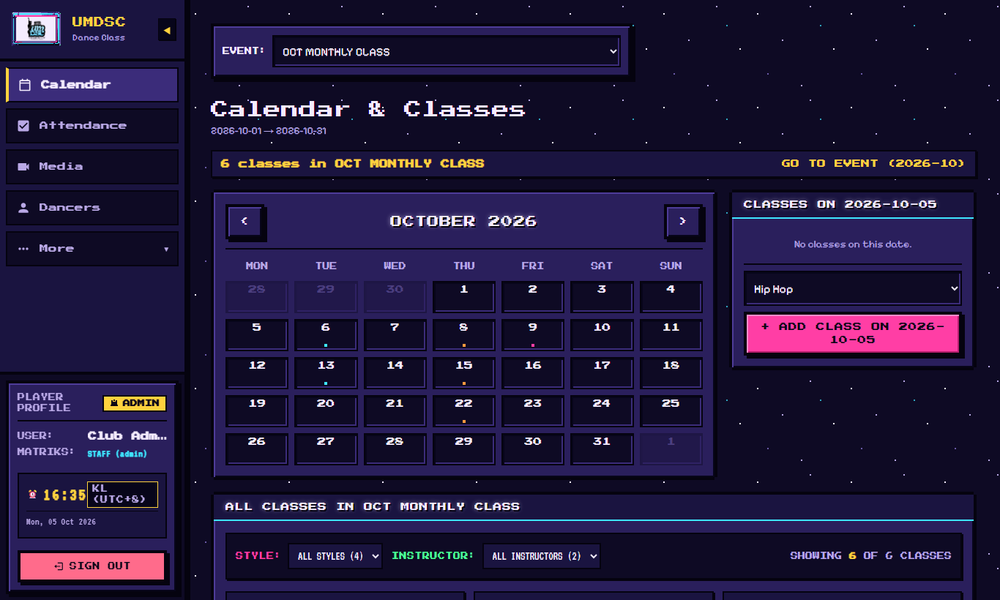

---

## 2. Events & Google Form slot auto-gating

Every monthly class, trial class, or workshop is created as an **Event**.

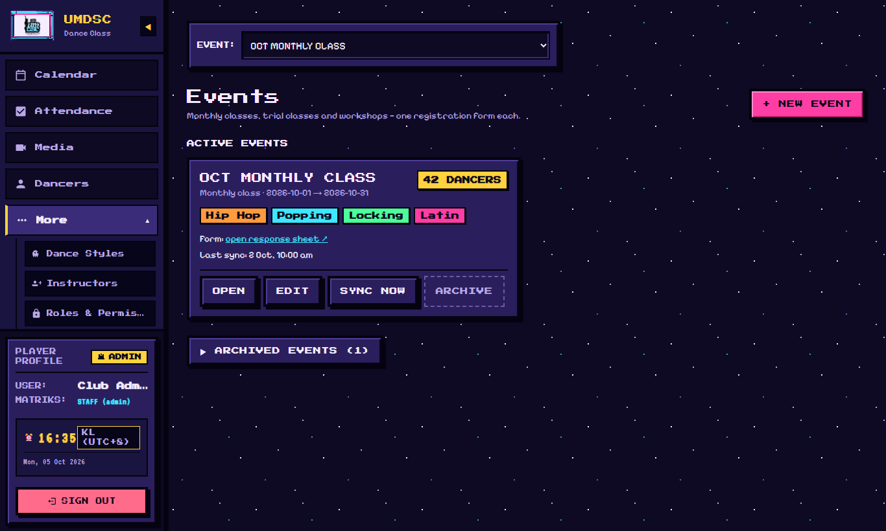

### The Event Creation Wizard (`/admin/events/new`)

Before launching a new event:
1. Create the event's **Google Form** and connect it to a **Google Sheet response spreadsheet**.
2. **Share both the Google Form and the response sheet with `umdancesportc@gmail.com` as Editor.**

Navigate to **Events › + NEW EVENT** and proceed through the steps:

1. **FORM LINK & RESPONSE SHEET:**
   - **Google Form Edit URL (`formUrl`):** Paste the edit URL of the Google Form (e.g. `https://docs.google.com/forms/d/.../edit`). This enables the system to automatically close the form when style capacity is reached!
   - **Response Sheet Link:** Paste the linked Google Sheet URL and select the question column where dancers choose their dance style(s).
2. **DETAILS & CAPACITY GATING:**
   - **Event Name:** (e.g. `2026-11 Monthly Classes`).
   - **Event Type:** `monthly`, `trial`, `workshop`, or `other`.
   - **Per-Style Slot Limits (`styleSlots`):** Specify the maximum dancer capacity per style (e.g. Locking: 25, Popping: 25, Hip Hop: 30, Latin: 20).
   - **Form Auto-Gating:** When registrations reach the slot limit, the backend automatically sets the Google Form status to closed, preventing overbooking!
3. **STYLES & INSTRUCTORS:**
   - Select dance styles taught in the event.
   - Assign multiple instructors per style (`instructorIds`) with distinct signature colors.
   - Map any custom form answer strings to canonical styles using aliases.
4. **SCHEDULE GENERATION:**
   - Use **AUTO-FILL** for each style (day of week, start time, end time, venue, number of sessions) to generate all class sessions in bulk.
5. **REVIEW & CREATE:** Confirm details and create the event.

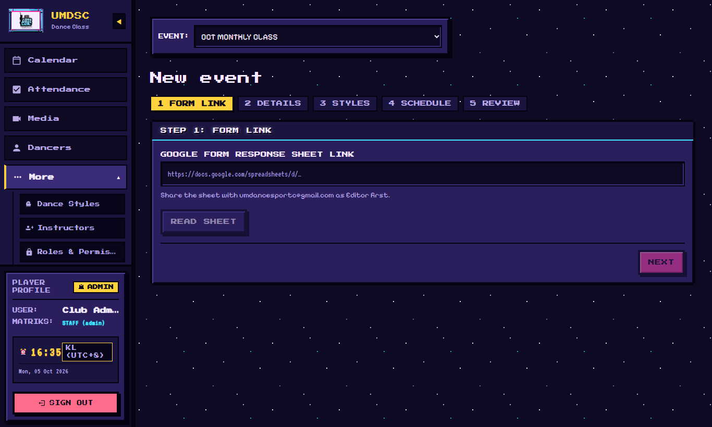

### Automated synchronization & Incomplete Row Guard
- **1-Minute Throttled Auto-Sync:** The background engine checks the response sheet every 60 seconds with single-read optimization.
- **3-Layer Incomplete Sheet Row Guard:** Dancers actively submitting Google Forms sometimes create transient rows with empty fields. The sync engine automatically filters out incomplete rows (missing names, missing matric numbers, or partial timestamps) so corrupt rows never enter the database or crash attendance grids.
- **10-Minute Form Status Sync:** A bidirectional check runs every 10 minutes. If an administrator manually reopens or closes the Google Form in Google Forms, the system syncs the status automatically without requiring manual intervention.
- **Manual Sync (`SYNC NOW`):** Force an immediate sync from the Events page whenever immediate updates are required.

### Reopening Full Classes & Closed Google Forms (`REOPEN / + SLOTS`)
- Whenever any dance style on an active event reaches capacity or the Google Form is closed (`FORM CLOSED`), the event card displays a **`REOPEN / + SLOTS`** button.
- Clicking **`REOPEN / + SLOTS`** opens the **REOPEN & ADD SLOTS** modal where you enter **`+N` Add-On Slots** (`>= 1`) for the class(es) you want to reopen.
- The system calculates each reopened class's new slot limit as `Math.max(currentSlotLimit, currentEnrolledCount) + addOnSlots`, re-arms capacity alerts for the new limit, restores the class choice on the Google Form, and reopens the Google Form immediately.
- **Note on manual overrides:** Manually adding or switching a dancer into a full class on `/admin/members` never reopens the Google Form automatically — use **`REOPEN / + SLOTS`** whenever you want public registrations to resume.

---

## 3. Dance styles

Navigate to **More › Dance Styles (`/admin/styles`)**.

| Field | Description |
|---|---|
| **Style Name** | Primary display name (e.g. *Popping*, *Locking*, *Hip Hop*, *Latin*). |
| **Aliases** | Comma-separated alternative names used in Google Forms (e.g. `hiphop, hip-hop, urban`). |
| **Color Swatch** | Primary theme color displayed on calendars and class tags. |
| **Defaults** | Default day of week, start/end time, default instructor, and default studio venue. |
| **Attendance & Video Folders** | Optional master Google Drive folder links for attendance sheets and video archives. |

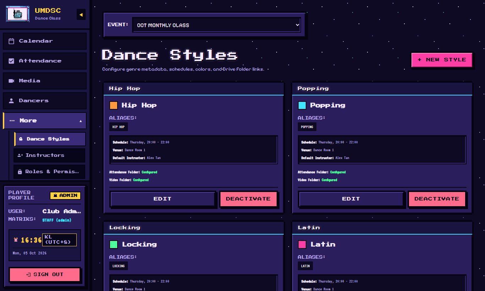
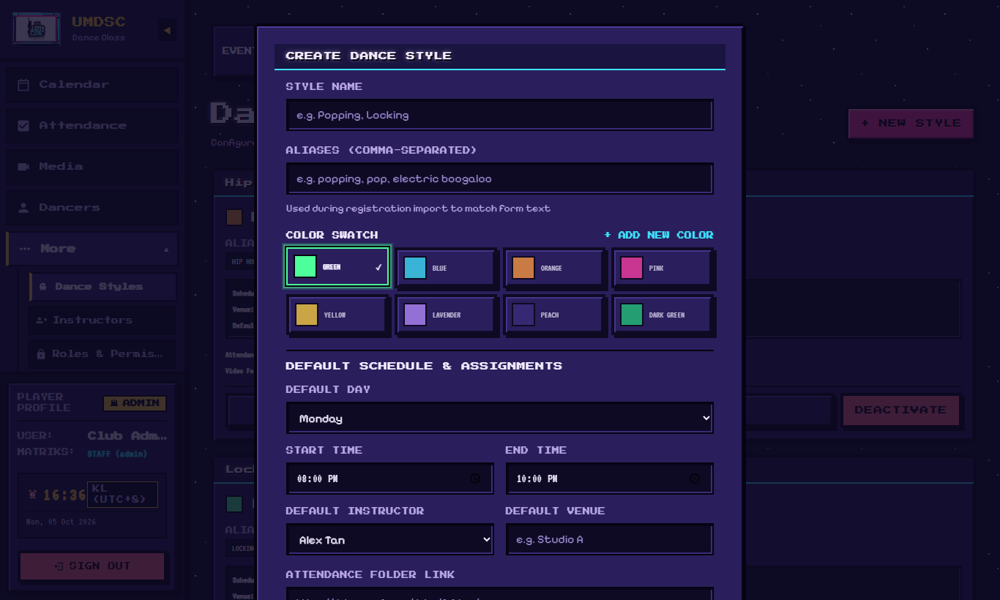

---

## 4. Instructors

Navigate to **More › Instructors (`/admin/instructors`)**.

- Click **+ NEW INSTRUCTOR** to register instructors.
- Provide **Full Name**, **Contact / WhatsApp**, and an **Instructor Signature Color** used on class schedules.
- Add profile pictures via **+ UPLOAD PICTURE** (recommended 1080 × 1350 portrait) or **+ LINK URL**. You can store multiple photos; the one designated **ACTIVE** is presented on dancer cards.

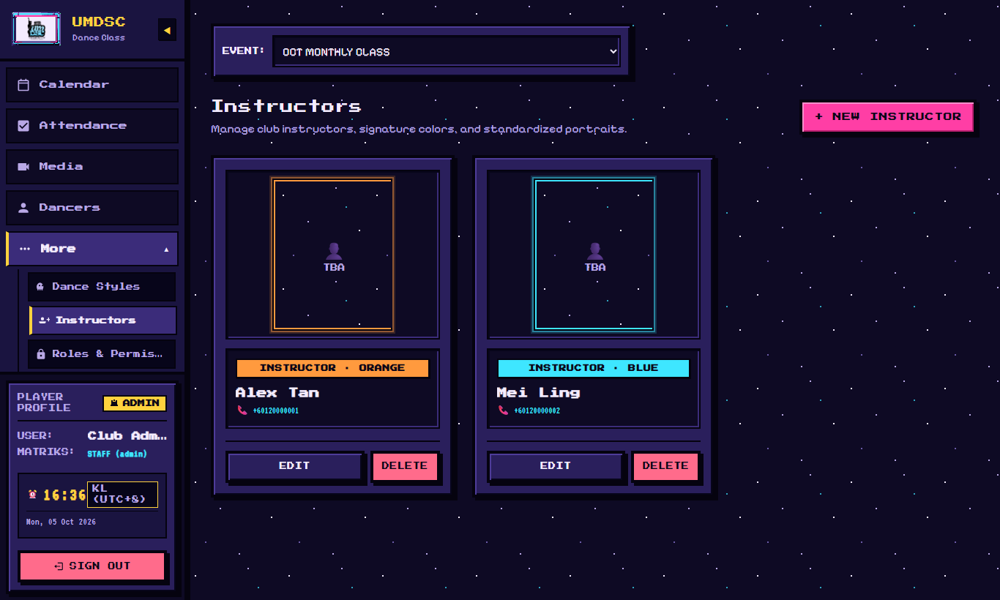
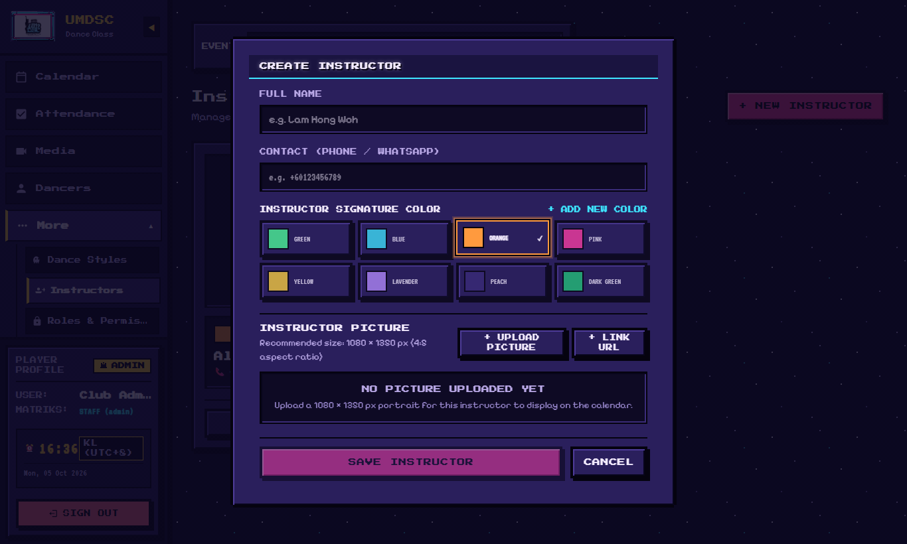

---

## 5. Classes & Session Editor

Open **Calendar (`/admin/calendar`)** to view all class sessions for the active event.

- Filter sessions by **Dance Style** or **Instructor**.
- Click any class session to open the **Session Editor**:
  - Update **Date**, **Time Range**, **Venue**, **Instructor** (or designate a replacement instructor), and internal notes.
  - Class status can be set to `scheduled`, `replacement`, or `cancelled`.
  - **Walk-In Class Code:** View or regenerate the unique 7-character guest pass code (e.g. `LCK-7X9`) and copy it with **COPY CODE**.

---

## 6. Dancers & Player Profile Cards

Open **Dancers (`/admin/members`)** to view all registered dancers.

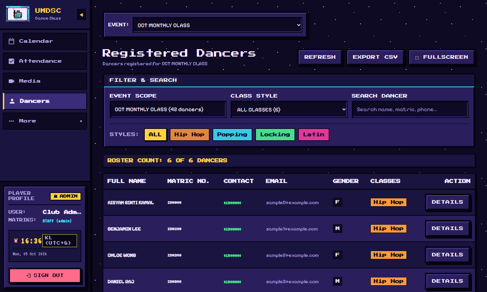

### Direct Dancer & Class Enrollment Management (`/admin/members`)
Admins (`members.import` permission) can manage dancer registrations and class enrollments directly on the website without manually editing Google Sheets:

1. **Adding a New Dancer (`+ ADD DANCER`):**
   - Click **`+ ADD DANCER`** in the toolbar to register a dancer into any active event.
   - Enter their **Full Name**, **Matric Number**, optional contact details, and tick one or more **Dance Classes**.
   - **Admin Slot Override:** If a class has already reached capacity (`FULL — ADMIN OVERRIDE (FORM STAYS CLOSED)`), admins can still enroll the dancer on the website; the system writes their row to the Google Form response sheet, syncs attendance and `MemberIndex`, sends their confirmation email (if an email was entered), and keeps the public Google Form / full class option **closed**.
2. **Player Profile Cards & Editing (`DETAILS` / `INFO` → `EDIT DETAILS`):**
   - Clicking **DETAILS** (desktop) or **INFO** (phone) opens the dancer's **Player Profile Card**, showing their matric number, direct **WHATSAPP** and **MAILTO** links, gender, nationality, registration timestamp, enrolled classes, and system flags.
   - Click **`EDIT DETAILS`** to correct personal details **or add, change, and drop Dance Classes** via the class checkboxes, then click **`SAVE TO FORM SHEET`**. Saving updates the primary row in the Google Form response sheet and clears any older duplicate submission rows so dropped classes are never re-added on future syncs.
3. **Removing a Dancer (`REMOVE FROM EVENT`):**
   - Inside **`EDIT DETAILS`**, click **`REMOVE FROM EVENT`** → **`CONFIRM REMOVE`** to remove a dancer who quit an event. This clears all of their response rows in that event's Google Form response sheet and triggers an immediate sync.
4. **Automatic Attendance & Database Cleanup:**
   - Whenever a dancer changes or drops a class, or is removed from an event, the sync engine automatically purges them from the dropped style's `Attendance` sheet (**even if they had prior `/` attendance ticks**) and removes the dropped event/style from `MemberIndex`. When 0 active events remain for that dancer, their `MemberIndex` sign-in profile is automatically deactivated (`active: false`).
5. **Converting Walk-Ins:** When a guest attends via a Walk-In pass, admins can register or link them with a formal matric number upon enrollment.

---

## 7. Media & Hybrid Video Management

Navigate to **Media (`/admin/media`)**.

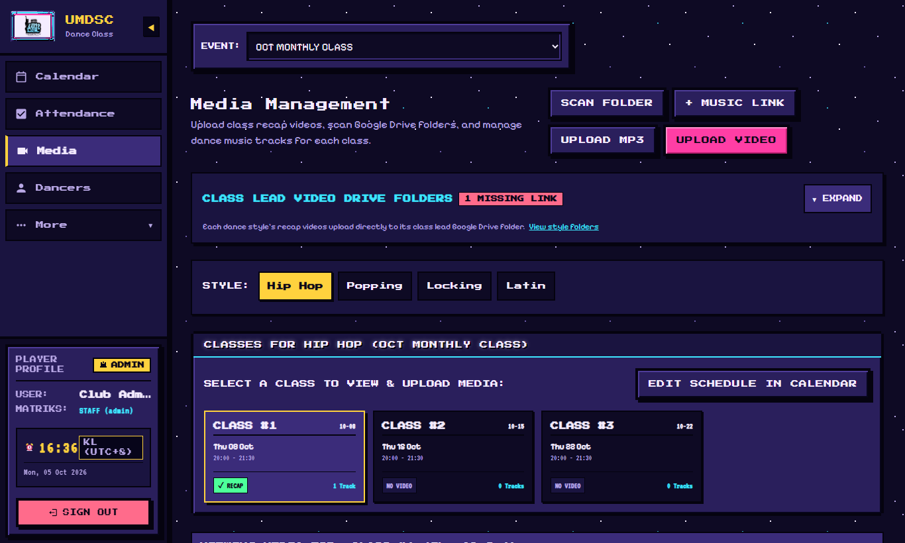

- **Class Lead Video Drive Folders:** Expand to manage upload folder links for each dance style. Each folder must be shared with `umdancesportc@gmail.com` as Editor.
- **Authorize Account:** Click **AUTHORIZE** while signed in as the class lead's Google account to bind uploads to that account.
- **Consolidated Batch Email Alerts:** When multiple class recap videos are uploaded in one batch, the system triggers `videos.notifyBatch`, delivering a single elegant notification email to dancers rather than individual emails per file.

---

## 8. Roles & dynamic permissions

Navigate to **More › Roles & Permissions (`/admin/roles`)**.

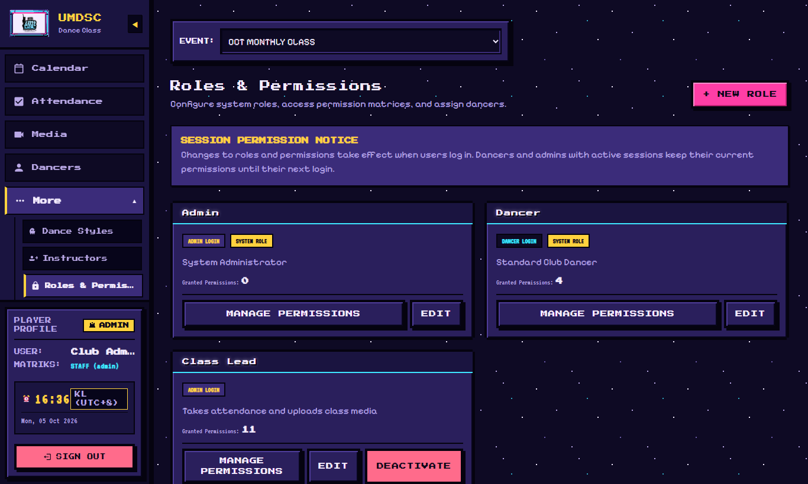

### Built-in roles
1. **Admin (`admin`):** Full system control across all features and master settings.
2. **Class Rep (`class_rep`):** Pre-configured system role for class leaders. Grants `attendance.view.all`, `attendance.edit`, and `export.download`.
3. **Dancer (`dancer`):** Read access to calendar, videos, shared music library, and personal attendance history.

### Style-Scoped Assignments (`assignedStyleIds`)
In **Roles & Permissions**, clicking a role opens the **Member Roles Panel**:
- Assign specific dancers or club leaders to a role.
- Scoping by dance style: You can restrict their role to specific styles (e.g. *Locking only*). Their administrative interface automatically restricts attendance rosters and media controls to those assigned styles.

---

## 9. Admin accounts

Navigate to **More › Admin Accounts (`/admin/admins`)**.

- Click **+ NEW ADMIN** to create accounts for committee members and class leads:
  - Enter **Username**, **Display Name**, **Initial Password**, and select their **Assigned Role**.
- **Password Reset:** Click **RESET PASSWORD** to assign a new temporary password.
- **Deactivation:** When an executive member steps down, click **DEACTIVATE** to immediately revoke access without deleting audit history.

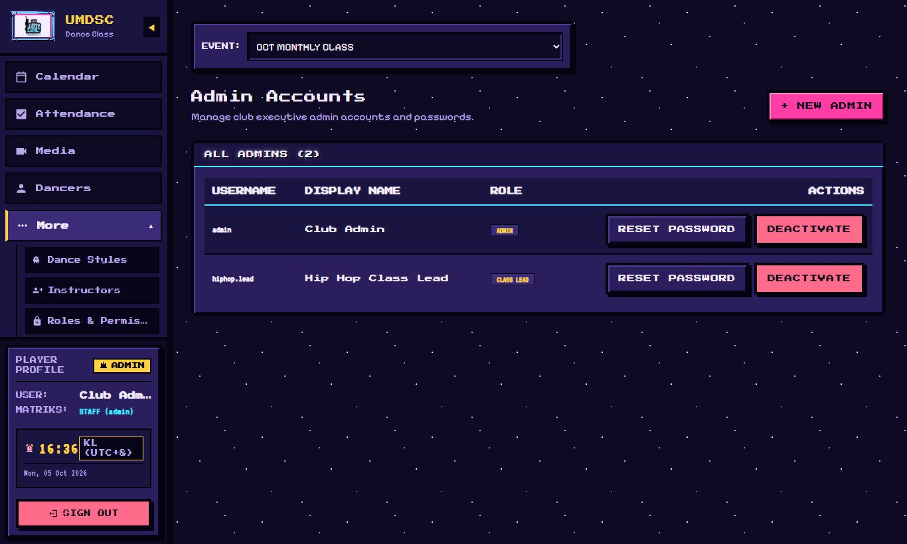
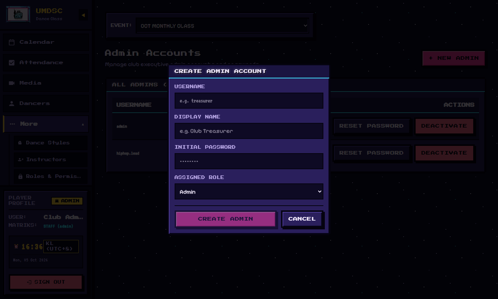

---

## 10. System settings & mascot notifications

Navigate to **More › System Settings (`/admin/settings`)**.

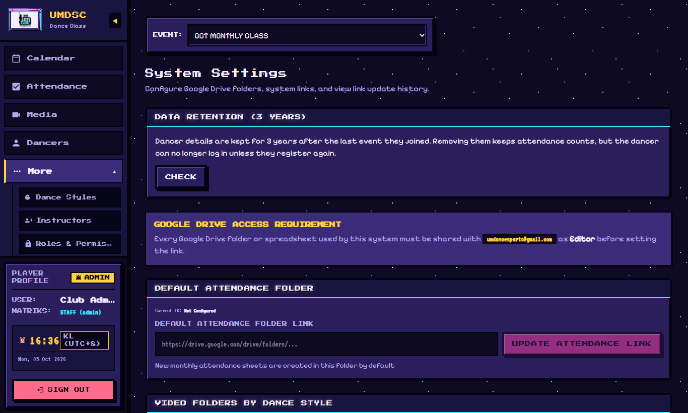

1. **Default Attendance Master Folder (`UPDATE ATTENDANCE LINK`):**
   - The root Google Drive folder where monthly attendance spreadsheets are created.
2. **Default Video Master Folder (`UPDATE VIDEO LINK`):**
   - The root fallback archive for video folders.
3. **Admin Email Manager (`adminNotificationEmails`):**
   - Add or remove committee member email addresses that receive automated system alerts (e.g. when a dance style reaches slot capacity and its Google Form closes).
4. **Data Retention Settings (3 Years):**
   - Automatically archives data older than the club's 3-year compliance window.
5. **Reset Test Data:**
   - Sandboxed reset utility for clearing mock test records prior to academic year launch.

### 8-Bit Mascot Notification Center
Located in the lower corner of the screen, the animated pixel mascot provides immediate ambient awareness:
- Click or tap the mascot to open the **Notification Drawer**.
- **New Dancers Tab:** Lists recently registered members across active events.
- **Slot Progress Tab:** Real-time visual progress bars showing registration counts versus slot capacity for each dance style.
- **System Audit Tab:** Real-time log of administrative actions (`memberRoles.assign`, `members.edit`, settings updates).
- Draggable and persistent across phone and desktop viewports.

---

## 11. Shared Music Library (`/admin/library`) & Studio (`/admin/studio`)

Admins have full access to the **Shared Music Library**:
- Browse and search all music uploaded across all events and styles.
- Preview MP3 audio inline.
- Click **▶ PLAY IN STUDIO** to jump directly into `/admin/studio` with the track loaded for choreography rehearsals.
