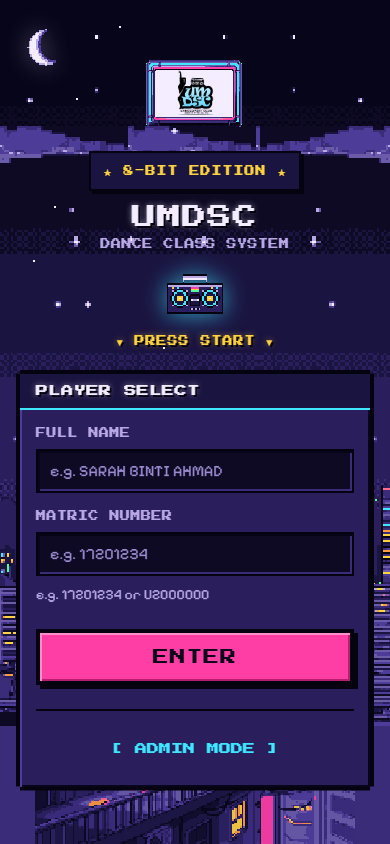
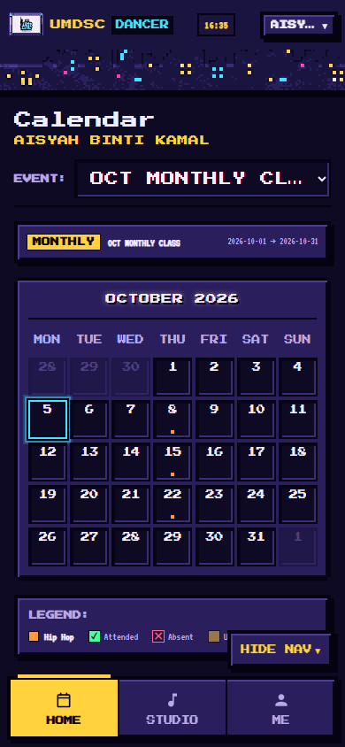
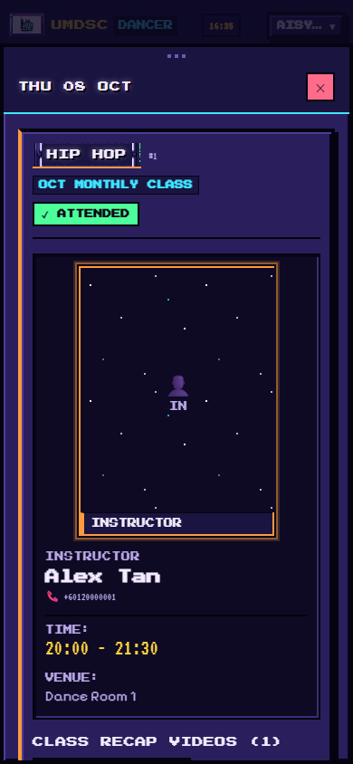
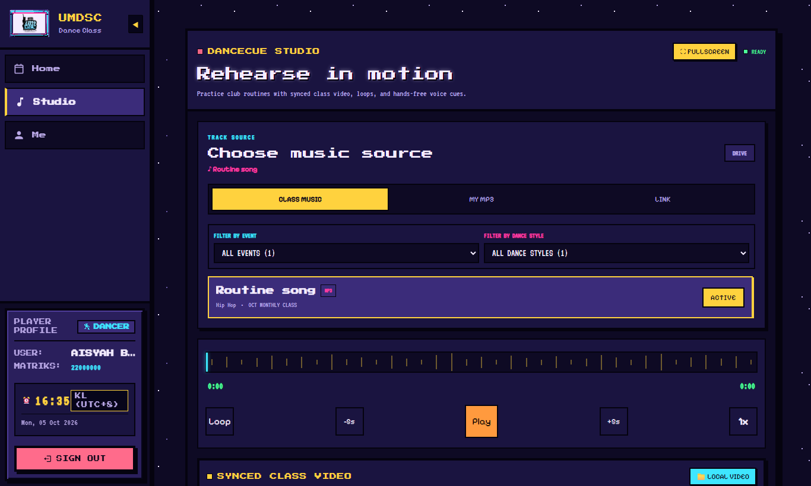
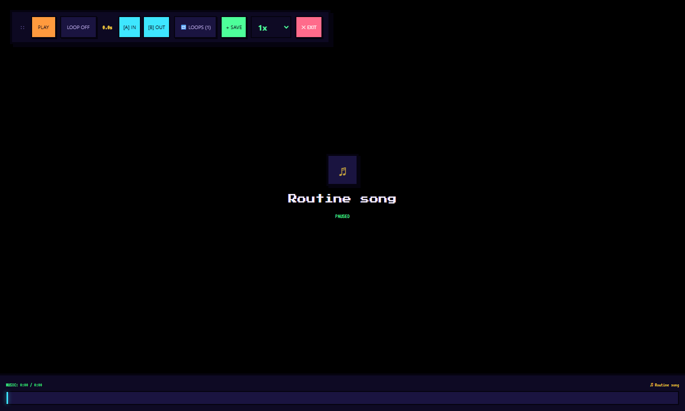
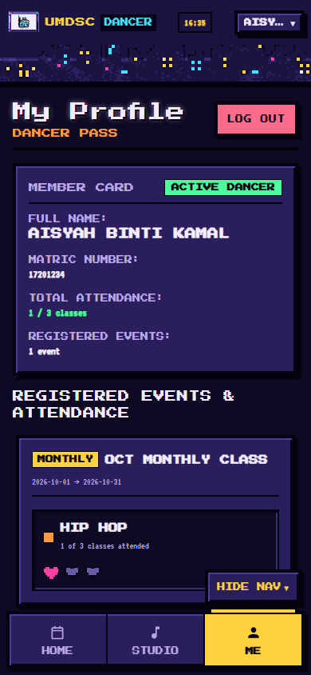

# Dancer Guide

**For:** University of Malaya Dancesport Club (UMDSC) dancers and members.  
**Website:** [https://umdsc-dance-class.umdancesportc.workers.dev](https://umdsc-dance-class.umdancesportc.workers.dev)  
**Devices:** Mobile phones and computers.  

Use the website to check your class schedule, watch class choreography recaps, practice music in the interactive Studio, explore the club-wide Shared Music Library, and track your attendance.

> 💻 **Device Tip:** The calendar and profile are optimized for mobile phones. For the **Music Studio** (practising with looping music and video), a **laptop or PC** with Google Chrome offers the best experience with full keyboard shortcuts and hands-free voice cue commands.

---

## 1. Logging in

Navigate to the homepage: [https://umdsc-dance-class.umdancesportc.workers.dev](https://umdsc-dance-class.umdancesportc.workers.dev)

### Fast login & smart autocomplete
1. **Registered Members:**
   - **Full Name or Student ID (Matric):** Start typing your name or matric number (e.g. `22001234`).
   - **Smart Autocomplete:** As you type, the system provides instant suggestions matching registered club dancers.
   - **Matric Privacy Protection:** When searching by name, student matric numbers are partially masked (e.g. `2200****`) to safeguard member privacy.
   - Click your name and tap **ENTER** to sign in.
2. **1-Tap Quick Resume:**
   - On returning visits from the same device, your profile card is remembered. A single tap on your card resumes your session instantly without retyping credentials.
3. **Guest / Walk-In Pass (`⚡ WALK-IN PASS`):**
   - If you did not sign up through the monthly Google Form and are attending as a guest, switch to the **⚡ WALK-IN PASS** tab.
   - Enter the 7-character **Walk-In Class Code** provided by your class lead (e.g. `LCK-7X9`) and your name.
   - You receive immediate guest access to that class session's recap videos and practice tracks!

### Install to your phone's home screen
- **iPhone (Safari):** Tap **Share** (square with up arrow) › **Add to Home Screen**.
- **Android (Chrome):** Tap **⋮** (three dots) › **Add to Home screen** or **Install App**.

---

## 2. Your calendar (`Home`)

The **Home (`/`)** screen displays a personalized calendar of your registered classes.

- Each coloured indicator represents a dance style (e.g., Popping, Locking, Hip Hop, Latin).
- Tap any **scheduled class day** to open the class detail drawer:
  - Time, venue, instructor details, and any special announcements or replacement instructor notes.
  - Links to that day's **recap videos** and **music**.
  - Walk-in pass codes for friends attending as guests.

---

## 3. Shared Music Library (`/library`)

Tap **Library** in the bottom navigation bar to open the **Shared Music Library**.

- **All-Access Catalog:** All registered club dancers can access the complete music library across **all dance styles** (Hip Hop, Popping, Locking, Latin, etc.), including songs from styles you did not register for!
- **Style Category Filter:** Tap style filter pills to instantly see songs curated for specific dance genres.
- **Search:** Search across song titles and artist names in real time.
- **Inline Audio Preview:** Tap the play icon next to any MP3 track to listen to an instant preview directly on the page.
- **External Links:** Direct buttons to open tracks on **Spotify**, **YouTube**, **SoundCloud**, or download original MP3s.
- **Studio Shortcut (`▶ PLAY IN STUDIO`):** Tap the cyan button to load any song directly into the **Music Studio** for choreography practice!

---

## 4. Music Studio (`/studio`) 💻

Open **Studio** from the navigation bar.

### Choosing your practice audio
1. **Music Library Tab:** Browse or search club tracks by dance style and load them with one tap.
2. **My MP3 Tab:** Load local `.mp3` or `.wav` audio files directly from your computer or phone.
3. **Link Tab:** Paste links from **YouTube**, **Spotify**, **SoundCloud**, or **Google Drive**.

### Practice controls
- **Playback & Scrubbing:** Play, pause, jump `-5s` or `+5s`.
- **Speed & Pitch Control:** Slow playback down (e.g. `0.75x`, `0.85x`) to break down fast choreography, or speed it up (`1.1x`, `1.25x`) for challenge drills.
- **Loop Markers (`IN` / `OUT`):**
  - Instructor choreography sections (e.g. *Chorus routine*, *Floorwork combo*) appear automatically.
  - Set custom loops: Click **IN** at your desired start time and **OUT** at the end time to loop any section continuously.
- **Synced Class Video:** Select your class recap video to play simultaneously alongside the music track. Use **SET START HERE** to synchronize video movement to the beat.
- **Fullscreen Mode:** Tap **FULLSCREEN** for a distraction-free, mirror-friendly rehearsal view with floating playback controls.

### Voice Cue (hands-free control)
Click the microphone button under **Voice Cue** in Chrome to control playback completely hands-free while dancing:
- *"Play"* / *"Pause"*
- *"Loop"* / *"Restart"*
- *"Back 5 seconds"* / *"Forward 10 seconds"*
- *"Slower"* / *"Normal speed"*

---

## 5. Me & profile self-service (`/me`)

Tap **Me** in the navigation bar to manage your member account.

- **Attendance Hearts Bar:** Visual hearts showing your attendance record across all registered classes this month.
- **Member Status:** Shows whether you are holding an **ACTIVE DANCER** pass or a temporary **WALK-IN PASS**.
- **Edit Profile (`EDIT INFO`):**
  - Dancers can update their **Full Name** and **Matric Number** at any time.
  - When saved, your changes automatically update your member profile and synchronize directly back to your active registration rows in the club's Google Form response sheets!
- **Log Out:** Tap **LOG OUT** when using a public rehearsal laptop.

---

## 6. 8-Bit Mascot Notification Center

Keep an eye on the animated retro pixel mascot in the bottom corner of your screen!
- The mascot dances, rests, and alerts you when new updates arrive.
- Tap the mascot to open your **Dancer Notification Drawer**:
  - **My Classes:** Instant access to your recent class recap videos and audio tracks.
  - **Upcoming:** Reminder countdowns for your next scheduled dance classes.
  - **Practice:** Recently added songs in the Shared Music Library.
