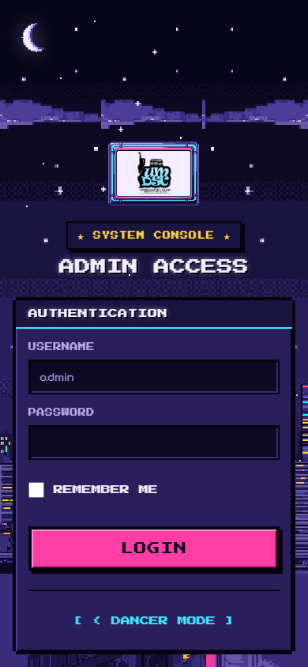
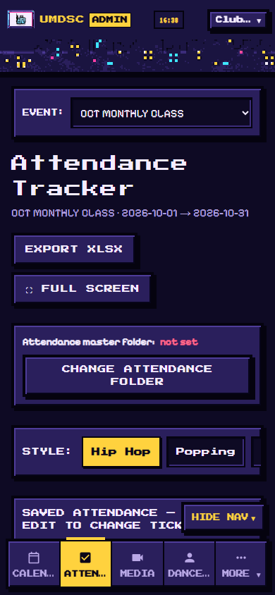
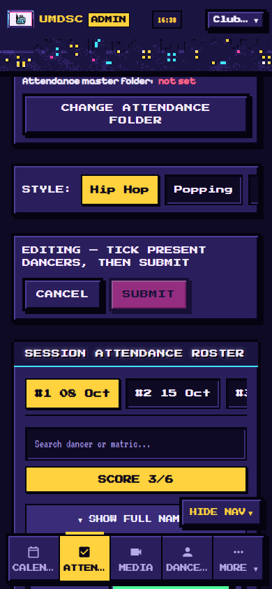
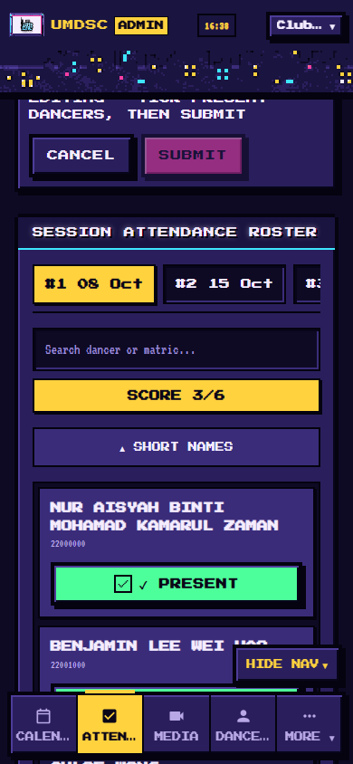
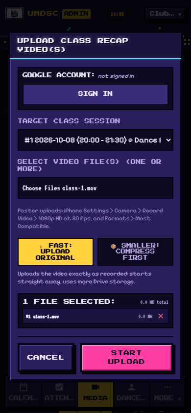

# 课程负责人与点名负责人使用指南 (Class Lead & Class Rep Guide)

**适用对象：**负责点名、接待 Walk-in 临时舞者、上传课程回顾视频与音乐的课程负责人（Class Lead）及点名负责人（Class Rep）。  
**网站：**[https://umdsc-dance-class.umdancesportc.workers.dev](https://umdsc-dance-class.umdancesportc.workers.dev)  
**设备：**手机或电脑皆可。授权 Google Drive 文件夹建议使用电脑操作（已用 💻 标出）。  

> 网站界面语言为英文，本指南中的**按钮、菜单与字段名称保留英文**，方便你在操作界面中对照查找。

---

## 1. 第一堂课之前（向管理员索取）

开课前，请向社团管理员确认以下设置：

1. **课程负责人账号：**管理员为你创建的**用户名（Username）**与**初始密码（Password）**，角色通常为内置的 **Class Rep (`class_rep`)** 或 **Admin**。
2. **专属舞种权限：**你的账号通常已绑定到特定的舞种（例如 *Locking* 或 *Hip Hop*）。系统会自动隐藏你不需要的管理功能标签，使界面简洁明了。
3. **加入 Google 登录名单：**你的个人 Gmail 必须已被加入 Google Cloud 的 OAuth 测试用户名单，否则在上传时 Google 会拦截登录。
4. **准备视频存放文件夹：**在你个人的 Google Drive 中新建一个文件夹（例如 “Locking Class Videos 2026”），然后**以编辑者（Editor）身份共享给 `umdancesportc@gmail.com`**，并将文件夹链接发给管理员录入系统。

> 💡 课程视频保存在**你自己的** Google Drive 文件夹中，占用的是**你自己的** Google 空间。

---

## 2. 登录与界面导航

1. 打开管理员登录页面：  
   [https://umdsc-dance-class.umdancesportc.workers.dev/admin/login](https://umdsc-dance-class.umdancesportc.workers.dev/admin/login)
2. 输入**Username**与**Password**，点击 **LOGIN**。

### 界面导航条
- **手机端导航：**位于屏幕底部的导航菜单包含：**Calendar（日历）· Attendance（点名）· Media（媒体）· Library（音乐库）· Dancers（舞者）· More（更多）**。
- **动态权限过滤：**如果你的账号是 **Class Rep** 角色，系统会自动隐藏无权限访问的页面（如系统设置或管理员账号），直接展示点名与课程相关功能。
- 在手机端如果导航条遮挡了列表内容，可以点击 **HIDE NAV** 隐藏；需要时点击 **SHOW NAV** 重新显示。

---

## 3. 点名操作 (Attendance)

1. 点击底部导航栏的 **Attendance**。
2. 确认顶部的 **EVENT** 选择器，选中当前月份的活动（例如 *NOV MONTHLY CLASS*）。
3. 选择你的 **STYLE**（例如 *Locking*）。
4. 点击你要点名的那一堂**课**（例如 **#3 18 Nov**）。

5. 点击 **EDIT** 进入点名编辑模式。
6. 为每位到场的舞者登记出席：
   - 点击该舞者右侧的 **ABSENT**（缺席）：按钮会变成亮绿色的 **✓ PRESENT**（出席）。如需撤回再次点击即可。
   - **SCORE** 计数器会实时显示当前已出勤的人数。
   - 使用 **Search dancer or matric…** 搜索栏，可通过姓名或学号快速查找舞者。
   - 若在窄屏手机上姓名被截断，点击 **▼ SHOW FULL NAMES** 展开完整姓名。网站会在你的手机上记住此设置。
7. 点名完毕后，务必点击 **SUBMIT** 保存记录。

### 点名实用小贴士
- **未保存提醒：**如果在点击 SUBMIT 前试图离开页面，浏览器会弹出防丢失提醒。
- **离线与断网容灾：**点名保存过程中如遇网络信号波动，系统会在本地队列中缓存操作并在网络恢复后自动提交；同时会启动屏幕防息屏唤醒锁（Wake Lock），确保数据顺利同步。
- **多端协作：**多位负责人可同时点名，他人提交的勾选记录会在约 20 秒内自动同步至你的屏幕。
- **导出与表格：**点击 **EXPORT XLSX** 可直接下载点名表 Excel 文件；点击 **sheet 链接**可在 Google Sheets 中实时查看主表格。

---

## 4. Walk-in 临时通行码与嘉宾签到

针对未提前填写 Google 表单、临时来到现场试课或补课的舞者：

1. 在 **Calendar** 日历页面（或点击课表中的单堂课），查看该堂课的 **Walk-In Class Code**（例如 `LCK-7X9`）。
2. 将此 7 位临时通行码告知到场嘉宾。
3. 舞者在登录界面选择 **⚡ WALK-IN PASS**，输入通行码与自己的姓名，即可立即登录并查看该堂课的回顾视频与练习音乐！
4. 在点名花名册中，该舞者会带有 **WALK-IN PASS** 标识。后续管理员也可在舞者详情卡片中将其转为正式注册学号。

---

## 5. 只需做一次：授权你的视频文件夹 💻

在第一次上传视频之前，需要在电脑上完成一次授权绑定：

1. 登录网站并进入 **Media** 页面。
2. 找到 **CLASS LEAD VIDEO DRIVE FOLDERS**，点击 **▼ EXPAND** 展开。
3. 检查顶部的 **Google account:**：
   - 若显示为你自己的个人 Gmail，直接进行下一步。
   - 若显示未登录或其它账号，点击 **SIGN IN** 或 **SWITCH ACCOUNT** 切换至你的个人 Gmail。
4. 在你的舞种这一行，点击 **AUTHORIZE**。
5. 弹出的 Google 云端硬盘选择器会显示你的视频文件夹，点击选中并点击 **Select**。
6. 列表行将更新显示为 **✓ AUTHORIZED**，并标注 **Uploads as** 你的个人 Gmail。

---

## 6. 上传课程回顾视频

1. 打开 **Media** 页面，确认顶部的 **EVENT** 与 **STYLE**。
2. 选中对应课程卡片，点击 **UPLOAD VIDEO**（或 **+ ADD RECAP FOR CLASS #N**）。
3. 确认 **Google account:** 显示为你已授权的 Gmail。
4. 确认 **TARGET CLASS SESSION** 选中了正确的课次。
5. 点击 **Choose Files**，从设备中选取一个或多个视频文件。
6. 选择上传模式：
   - **⚡ FAST: UPLOAD ORIGINAL：** 原画极速上传，不进行格式转换，保留原视频清晰度。适合在 Wi-Fi 环境下使用；对于小于 150 MB 的视频系统默认推荐此模式。
   - **📦 SMALLER: COMPRESS FIRST：** 浏览器端自动压缩至 720p H.264 后上传。大幅节约你的 Drive 空间和移动网络流量；对于大于 150 MB 的视频系统默认推荐此模式。
7. **批量邮件聚合提醒：** 默认勾选 **Notify dancers via email**。上传完毕后，系统会自动调用 `videos.notifyBatch` 接口，向该班级注册舞者发送**一封汇总邮件**，避免每个小视频重复轰炸舞者信箱。
8. 点击 **START UPLOAD** 开始上传，请保持屏幕常亮且不要切换浏览器标签，直至进度条显示 100%。

### 上传受阻排查指引

| 提示信息 | 解决办法 |
|---|---|
| *Class lead video folder link not inserted* | 联系管理员在系统设置中填入你的 Google Drive 文件夹链接。 |
| *…has no upload account yet* | 按照第 5 节完成一次文件夹授权绑定。 |
| *…uploads with X, but you're signed in as Y* | 点击页面顶部的 **SWITCH ACCOUNT** 切换至账号 X。 |
| *This class lead folder isn't authorized yet* | 请使用电脑端浏览器打开 Media 页面点击 **AUTHORIZE**。 |

### 删除视频
点击视频卡片上的 **DELETE** 并确认。视频将从系统移除，对应的 Drive 文件将移至**回收站**（可保留 30 天）。

---

## 7. 添加音乐至共享音乐库

系统提供全社团互通的**共享音乐库（Shared Music Library, `/library` 与 `/admin/library`）**。歌曲按**舞种**分类，既可以绑定单堂课，也可以作为通用风格练习曲。

在 **Media** 页面（或通过 **+ MUSIC LINK** / **UPLOAD MP3**）：

1. **添加音频链接 (`+ MUSIC LINK`)：**
   - 粘贴 **YouTube**、**Spotify**、**SoundCloud** 或 **Google Drive MP3** 链接。
   - 填写歌曲名称（**Track Title**）。
   - 在 **Link to Session** 下拉框中，既可选择某堂具体的课，也可选择：  
     `-- General Style / Event Library Track --`（通用风格练习曲）  
     选择通用曲目后，该音乐会直接进入共享音乐库供全社团随时调用！
2. **上传本地 MP3 (`UPLOAD MP3`)：**
   - 选取本机的 `.mp3` 音频文件。
   - 选择目标课次或 `-- General Style / Event Library Track --`。
   - 音频将直接保存至对应舞种的 Drive 文件夹并入库。
3. **练习室快捷启动 (`▶ PLAY IN STUDIO`)：**
   - 在 **Library** 页面（`/admin/library`），点击任一曲目上的 **▶ PLAY IN STUDIO**，即可直接载入音乐练习室开启排练。

### 设置循环小节 (Sections)
在任一音乐曲目下方点击 **MANAGE SECTIONS**：
- 为特定动作组合设置起止时间（例如 *Chorus part A*，从 0:15 至 0:45）。
- 舞者在练习室中可一键点选该组合进行无缝循环练习。

---

## 8. 每周上课常规自查表

- [ ] **课前：** 查看课表，备好该堂课的临时通行码（Walk-In Code，如 `LCK-7X9`）。
- [ ] **课中：** 打开 **Attendance** → 选择舞种与课次 → 点击 **EDIT** → 勾选出勤 → 点击 **SUBMIT**。
- [ ] **课后：** 打开 **Media** → 点击 **UPLOAD VIDEO** → 上传当日动作回顾视频（保持屏幕常亮）。
- [ ] **音乐管理：** 添加课上排舞音乐链接或 MP3，并为重点编舞段落标注循环小节。
