# 管理员指南 (Admin Guide)

**适用对象：**社团执委会成员及系统管理员。  
**网站：**[https://umdsc-dance-class.umdancesportc.workers.dev/admin/login](https://umdsc-dance-class.umdancesportc.workers.dev/admin/login)  
**推荐设备：**笔记本电脑或台式电脑（虽然所有管理页面均完美支持手机端操作，但涉及 Google 表单对接与多舞种排课时，大屏操作更为从容高效）。  

管理员拥有全部课程负责人权限；点名操作与视频上传流程请参见《课程负责人指南》。本指南专述活动管理、Google 表单自动满额停收、舞种与师资配置、管理员权限分配以及全系统设置。

---

## 1. 登录与全局导航结构

在浏览器访问 **/admin/login**，输入管理员**用户名**与**密码**，点击 **LOGIN**。

### 导航布局
- 核心功能导航：
  1. **Calendar (`/admin/calendar`)：** 课表日程查看、单堂课编辑、Walk-in 通行码管理。
  2. **Attendance (`/admin/attendance`)：** 实时点名、Excel 格式导出与 Google Sheets 直达链接。
  3. **Media (`/admin/media`)：** 云端硬盘文件夹授权绑定、视频原画/压缩混合上传与音乐小节管理。
  4. **Library (`/admin/library`)：** 全社团共享音乐库，支持试听与一键启动练习室。
  5. **Dancers (`/admin/members`)：** 注册舞者花名册、学号/姓名搜索、玩家属性卡与手动同步。
  6. **More (`#more`)：** 展开查看全局基础数据及系统后台：
     - **Dance Styles (`/admin/styles`)：** 舞种管理
     - **Instructors (`/admin/instructors`)：** 导师名录
     - **Roles & Permissions (`/admin/roles`)：** 角色与权限控制
     - **Admin Accounts (`/admin/admins`)：** 管理员账号管理
     - **System Settings (`/admin/settings`)：** 系统核心设置
     - **Events (`/admin/events`)：** 活动与月份管理
- **动态权限过滤：** 当以特定角色（如 `Class Rep`）登录时，无权访问的管理标签页会自动被系统屏蔽，防止越权误触。

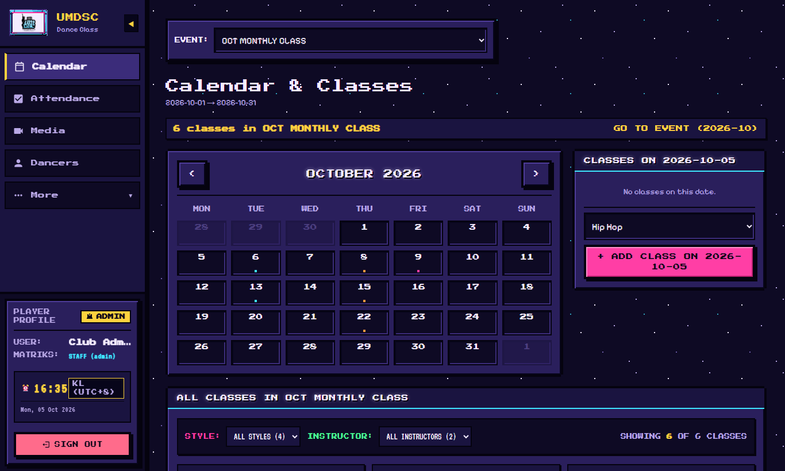

---

## 2. 活动配置与 Google 表单自动满额关停 (Event Wizard & Auto-Gating)

每月月度课、新生体验课或集训工作坊均在系统中建立为一个 **Event**（活动）。

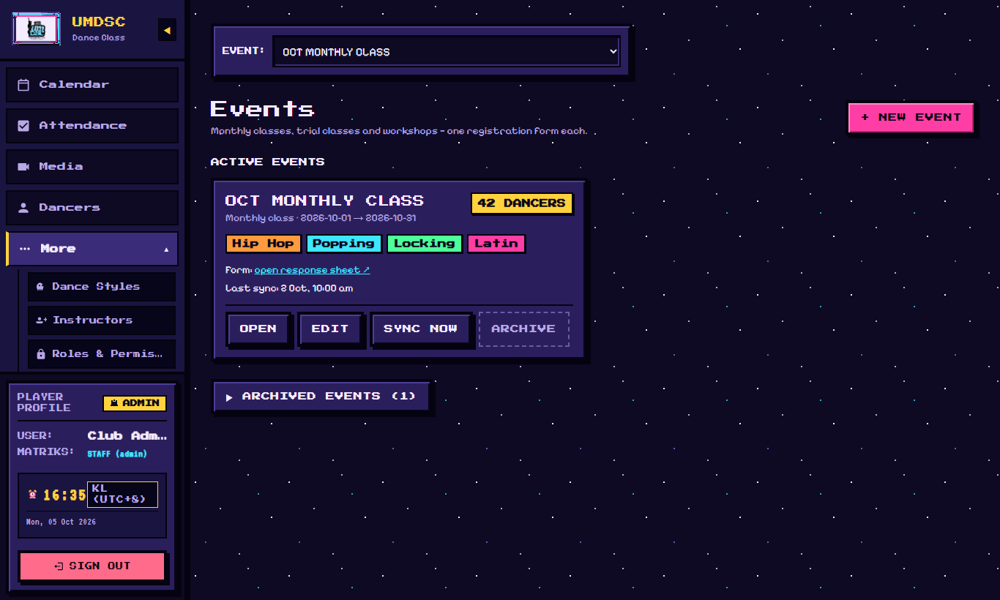

### 新建活动向导 (`/admin/events/new`)

在创建新活动前，请先准备好：
1. 建立该活动的 **Google Form** 报名表，并生成对应的 **Google Sheets 响应表格**。
2. **将该 Google Form 与响应表格均以编辑者（Editor）身份共享给 `umdancesportc@gmail.com`。**

进入 **Events › + NEW EVENT**，按照 5 步向导配置：

1. **FORM LINK & RESPONSE SHEET（表单对接）：**
   - **Google Form Edit URL (`formUrl`)：** 粘贴表单的编辑链接（例如 `https://docs.google.com/forms/d/.../edit`）。系统据此拥有自动开闭表单权限，当名额报满时自动切断报名！
   - **Response Sheet Link：** 粘贴 Google Sheets 响应表链接，并选取舞者选择舞种的问题列。
2. **DETAILS & CAPACITY GATING（详情与名额限制）：**
   - **Event Name：** 活动名称（如 `2026-11 Monthly Classes`）。
   - **Event Type：** 活动类型（月度课、体验课、工作坊等）。
   - **Per-Style Slot Limits (`styleSlots`)：** 为各舞种单独设置报名上限（如 Locking: 25, Popping: 25, Hip Hop: 30, Latin: 20）。
   - **自动满额关停机制：** 当某舞种有效报名人数达到上限时，后端系统会自动将该 Google 表单设为关闭状态并向管理员推送通知，彻底防止超额！
3. **STYLES & INSTRUCTORS（舞种与老师分配）：**
   - 勾选本活动开设的舞种。
   - 支持为单一舞种配置多名执教老师（`instructorIds`），并分配专属识别色。
   - 配置表单别名（Aliases），使表单中学员的不同书写习惯自动对应到正确舞种。
4. **SCHEDULE GENERATION（自动排课）：**
   - 对各舞种使用 **AUTO-FILL** 自动批量生成全月课表（星期几、时间、教室及总堂数）。
5. **REVIEW & CREATE（审核创建）：** 检查全部信息并完成创建。

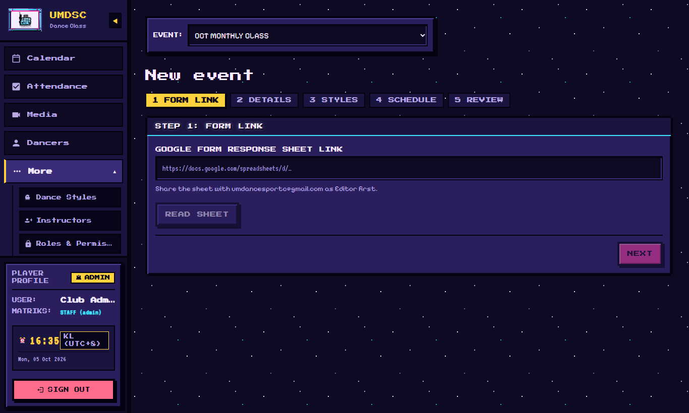

### 自动化同步机制与防残损数据守卫 (Incomplete Row Guard)
- **1 分钟节流自动同步：** 后台守护进程每隔 60 秒自动比对响应表哈希与新增行数，采用单次全读取优化，绝不超频消耗配额。
- **3 层残缺数据过滤守卫：** 学员在填写 Google 表单并发提交时，表格中常会产生瞬时空行或未填完的残破数据。系统自动拦截缺少姓名、学号或时间戳的残缺行，确保数据库零污染、点名册永不崩溃。
- **10 分钟双向表单状态巡检：** 每 10 分钟自动检查一次表单开闭状态。若管理员在 Google Forms 后台手动重新开放或提前关闭表单，系统能自动同步状态。
- **手动立即同步 (`SYNC NOW`)：** 在 Events 页面随时可点击强制执行同步。

---

## 3. 舞种配置 (Dance Styles)

进入 **More › Dance Styles (`/admin/styles`)**。

| 字段 | 说明 |
|---|---|
| **Style Name** | 舞种主名称（如 Popping, Locking, Hip Hop, Latin）。 |
| **Aliases** | 英文逗号分隔的别名（如 `hiphop, hip-hop, 街舞`），用于 Google 表单自动匹配。 |
| **Color Swatch** | 舞种专属荧光主题色，在课表与标签上高亮显示。 |
| **Defaults** | 默认上课星期、起止时间、默认主讲老师及常驻教室。 |
| **Attendance & Video Folders** | 选填的专属点名主目录与历史视频归档目录链接。 |

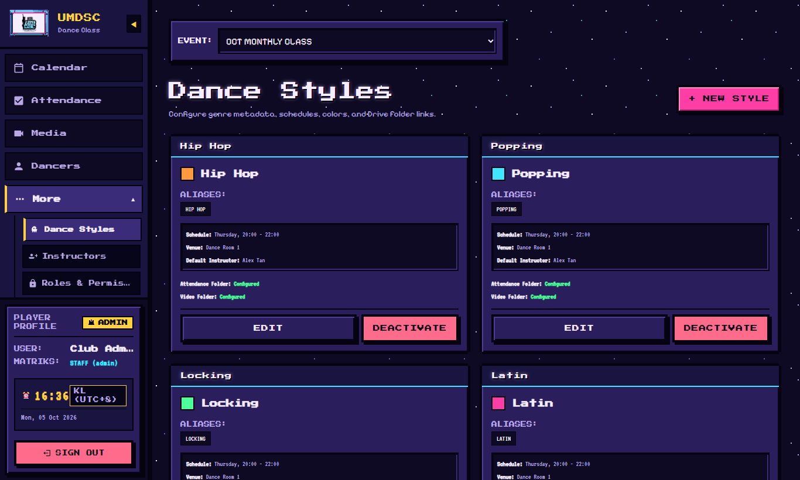
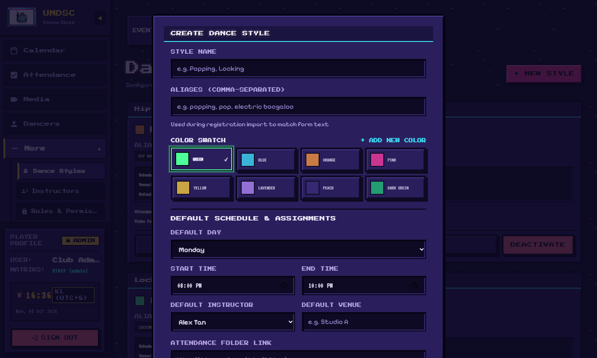

---

## 4. 导师名录 (Instructors)

进入 **More › Instructors (`/admin/instructors`)**。

- 点击 **+ NEW INSTRUCTOR** 录入授课老师。
- 填写**姓名**、**联系方式/WhatsApp** 及**签名专属色**。
- 支持通过 **+ UPLOAD PICTURE**（建议 1080 × 1350 竖屏半身照）或 **+ LINK URL** 添加宣传照。可上传多张备选，标记为 **ACTIVE** 的照片将展示在舞者日程卡片上。

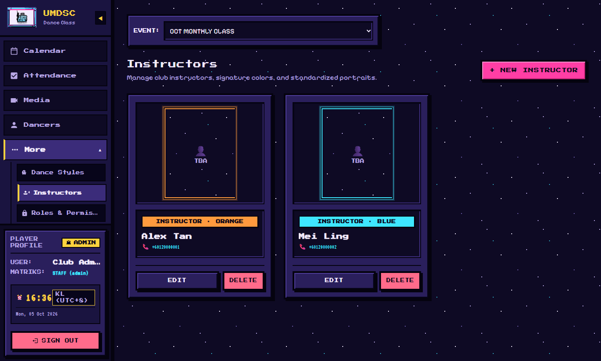
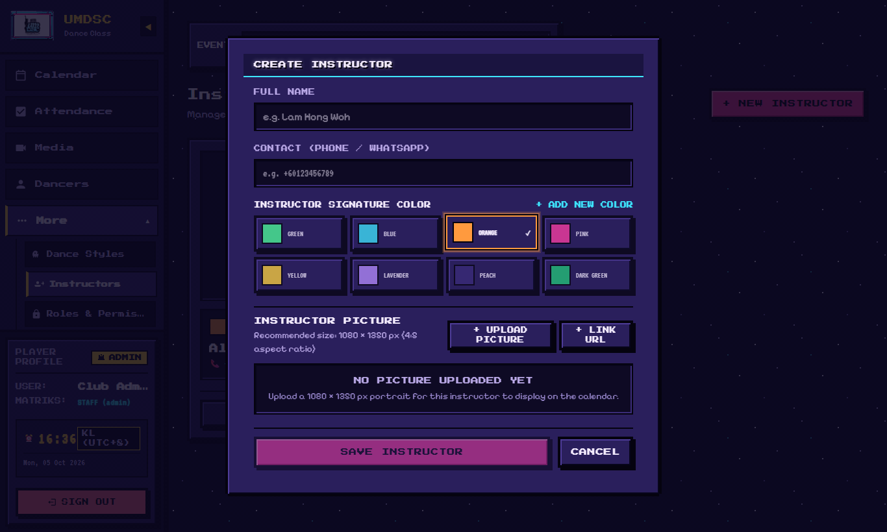

---

## 5. 课表与单堂课管理 (Calendar)

打开 **Calendar (`/admin/calendar`)** 查看当月排课日程。

- 按舞种或授课老师筛选课程。
- 点击任意单堂课可打开**课程编辑器 (Session Editor)**：
  - 修改上课日期、时间、教室场地、授课老师（或指定代课老师）及课程备注。
  - 课程状态可设为正常排课 (`scheduled`)、代课/调课 (`replacement`) 或停课 (`cancelled`)。
  - **Walk-In Class Code：** 查看或重新生成该堂课专属的 7 位临时通行码（如 `LCK-7X9`），点击 **COPY CODE** 复制提供给试课嘉宾。

---

## 6. 舞者花名册与玩家属性卡片 (Dancers & Player Profile)

打开 **Dancers (`/admin/members`)** 查看所有注册舞者。

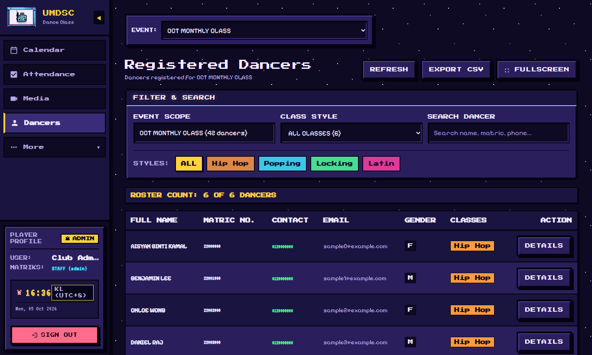

### 舞者属性卡片详情
点击任一舞者即可展开其专属**属性卡片**：
- 展示真实学号、带有直接唤醒功能的 **WHATSAPP** 电话链接、**MAILTO** 邮箱链接、性别、国籍、注册时间戳、已报舞种及系统标记。
- **编辑舞者资料 (`EDIT DANCER`)：** 当学员学号填错、姓名有拼写误差或更换电话时，管理员点击 **EDIT DANCER** 修改，系统会自动反向更新其在 Google 表单响应表格中的对应行数据！
- **转正临时嘉宾：** 当试课舞者凭 Walk-in 通行码上课后，管理员可在此为其补录正式学号并关联档案。

---

## 7. 媒体与视频混合架构 (Media)

进入 **Media (`/admin/media`)** 页面。

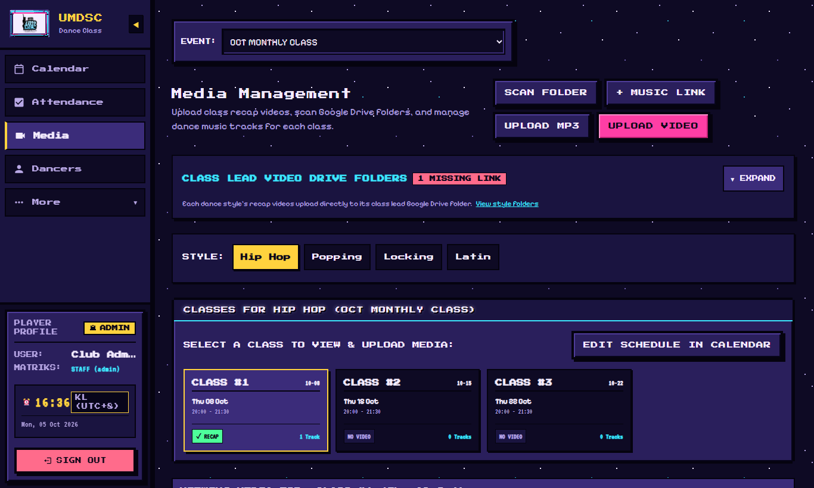

- **课程负责人 Drive 文件夹：** 展开管理各舞种的上传目录。每个目录均需以 Editor 权限共享给 `umdancesportc@gmail.com`。
- **账号授权绑定：** 登录对应负责人的个人 Google 账号后点击 **AUTHORIZE**，确保视频存储计费与配额绑定在该负责人的个人空间中。
- **批量邮件聚合提醒 (`videos.notifyBatch`)：** 批量上传多个视频时，系统自动发送一封聚合邮件，告别重复骚扰邮件。

---

## 8. 角色体系与动态权限管控 (Roles & Permissions)

进入 **More › Roles & Permissions (`/admin/roles`)**。

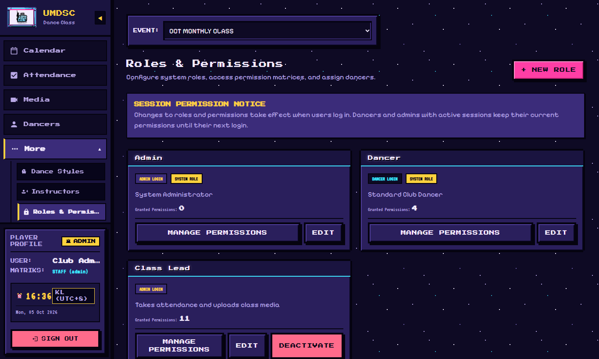

### 内置核心角色
1. **Admin (`admin`)：** 超级管理员，拥有全部业务操作与系统管理权限。
2. **Class Rep (`class_rep`)：** 内置的点名负责人角色，预设配置 `attendance.view.all`、`attendance.edit` 与 `export.download` 权限。
3. **Dancer (`dancer`)：** 注册舞者基础角色，支持查看课表、回顾视频、共享音乐库及出勤记录。

### 按舞种划分权限范围 (`assignedStyleIds`)
在 **Roles & Permissions** 中点击角色名下方的成员管理面板（Member Roles Panel）：
- 将特定账号分配给角色。
- **限定舞种范围：** 可为负责人限定特定的舞种（如仅限 *Locking*）。登录后其界面将仅展示所属舞种的花名册与课表，并隐藏无关管理页面。

---

## 9. 管理员与负责人账号 (Admin Accounts)

进入 **More › Admin Accounts (`/admin/admins`)**。

- 点击 **+ NEW ADMIN** 为新执委或点名负责人开通账号：
  - 录入**用户名**、**显示名称**、**初始密码**及**分配角色**。
- **重置密码：** 点击 **RESET PASSWORD** 为遗忘密码的成员分配新密码。
- **停用离任账号：** 执委换届时，点击 **DEACTIVATE** 即可立即注销其访问权限，原操作审计日志依然完整留存。

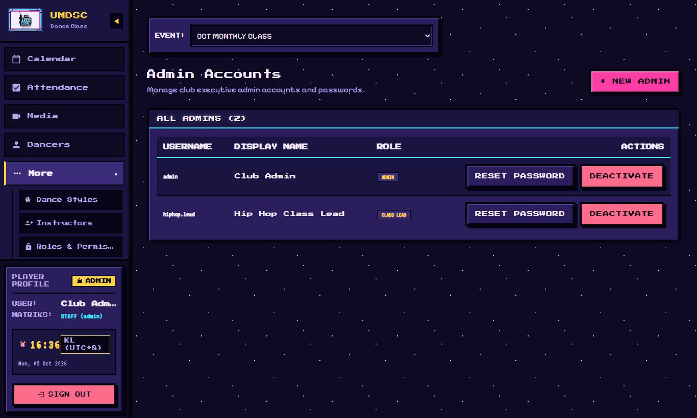
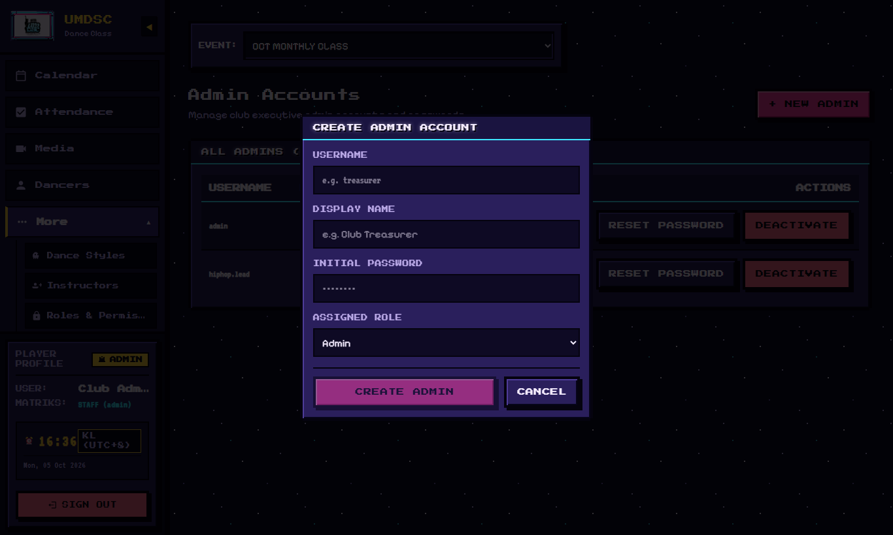

---

## 10. 系统设置与像素吉祥物通知中心 (System Settings)

进入 **More › System Settings (`/admin/settings`)**。

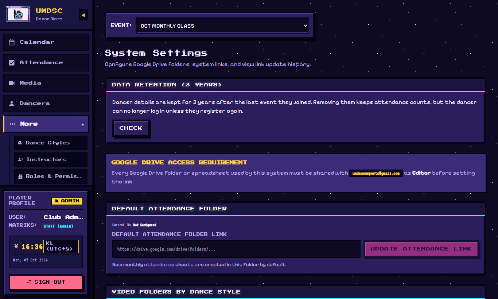

1. **默认点名主目录 (`UPDATE ATTENDANCE LINK`)：**
   - 系统自动生成每月点名表格的 Google Drive 根目录。
2. **默认视频主目录 (`UPDATE VIDEO LINK`)：**
   - 视频归档的默认云端硬盘备用目录。
3. **管理员通知信箱管理器 (`adminNotificationEmails`)：**
   - 配置接收满额告警和表单关停通知的执委邮箱列表，支持随时增删。
4. **数据保留周期 (3 年)：**
   - 依据社团规范自动对 3 年前的历史数据执行合规归档。
5. **重置测试数据 (Reset Test Data)：**
   - 供新学年正式上线前安全清理测试数据的沙箱重置工具。

### 8-Bit 像素吉祥物通知中心
位于屏幕右下角的小巧像素舞者吉祥物具备动作感知与状态提醒功能：
- 点击或轻触吉祥物可呼出**通知抽屉**。
- **New Dancers 标签页：** 实时展示最近报名的学员流水。
- **Slot Progress 标签页：** 直观柱状图展示各舞种当前报名进度与名额上限比。
- **System Audit 标签页：** 滚动记录权限变更、舞者修改等关键管理日志。
- 支持在手机端和电脑端自由拖拽停放。

---

## 11. 共享音乐库与练习室后台 (`/admin/library` & `/admin/studio`)

管理员享有**全社团共享音乐库**的完整管理权限：
- 随时查阅与检索所有舞种、所有往期活动的完整曲库。
- 点击播放图标实时在页面中试听 MP3 音频。
- 点击 **▶ PLAY IN STUDIO** 直接载入管理端练习室，辅助编舞与教学备课。
