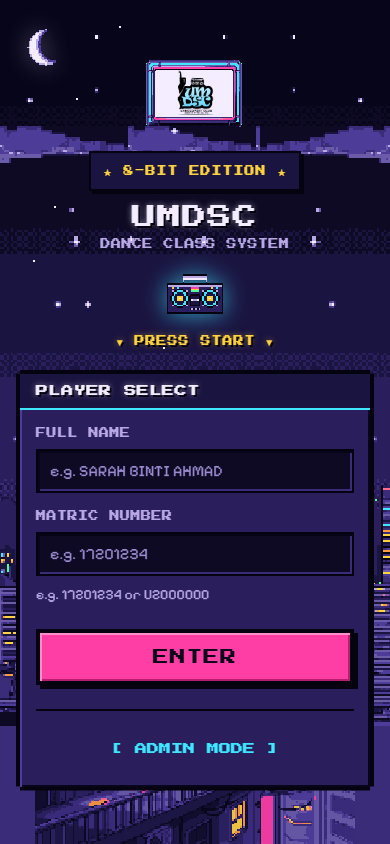
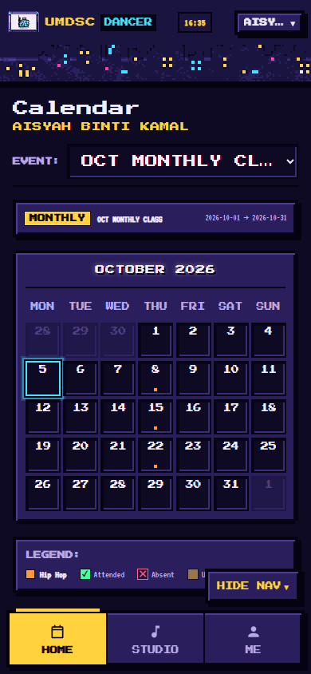
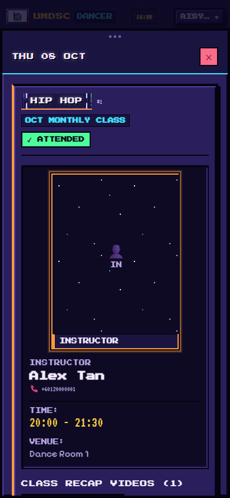
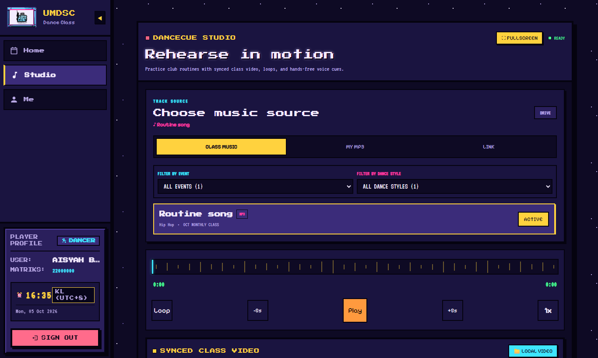
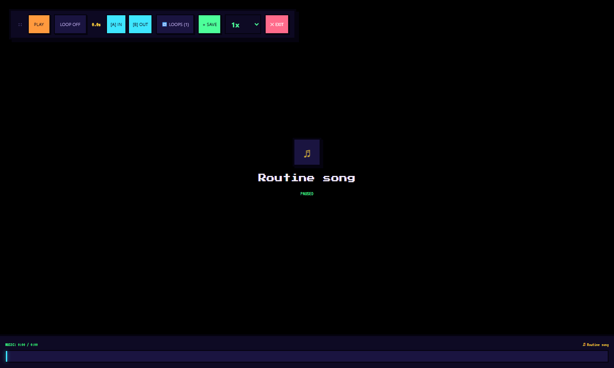
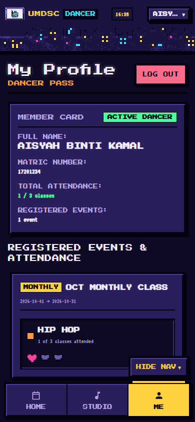

# 舞者指南 (Dancer Guide)

**适用对象：**马来亚大学国标舞与流行街舞社（UM Dancesport Club, UMDSC）全体舞者与社员。  
**网站：**[https://umdsc-dance-class.umdancesportc.workers.dev](https://umdsc-dance-class.umdancesportc.workers.dev)  
**设备：**手机与电脑均可使用。  

你可以通过本网站查看专属个人课表、观看每堂课动作回顾视频、在交互式练习室中跟练音乐、探索跨舞种共享音乐库，以及查询自己的出勤打卡记录。

> 💻 **设备小建议：** 查看课表和个人资料用手机最为便捷；而在**练习室 (Music Studio)** 练舞时，推荐使用**笔记本电脑或台式机**上的 Google Chrome 浏览器：大屏幕看动作更清晰，且支持键盘快捷键与免触控语音口令！

---

## 1. 登录与身份识别

打开网站首页：[https://umdsc-dance-class.umdancesportc.workers.dev](https://umdsc-dance-class.umdancesportc.workers.dev)

### 快速登录与智能联想
1. **正式注册学员：**
   - **输入学号或姓名：** 输入你的马大学号（如 `22001234`）或英文全名。
   - **智能自动补全：** 随着你的输入，系统会即时联想出匹配的学员姓名。
   - **学号隐私保护：** 搜索联想列表展示时，学号会自动进行脱敏脱隐处理（如 `2200****`），保护同学隐私。
   - 点选你的姓名后，点击 **ENTER** 即可登入。
2. **一键快捷续登（1-Tap Resume）：**
   - 在常用设备上再次访问时，系统会记住你的名片。无需重新输入学号，轻点名片即可一键瞬间进入系统！
3. **试课嘉宾临时通行证 (`⚡ WALK-IN PASS`)：**
   - 如果你尚未填写当月报名表，只是临时到场试课，请切换至 **⚡ WALK-IN PASS** 标签页。
   - 填入课程负责人提供的 7 位临时通行码（例如 `LCK-7X9`）及你的姓名。
   - 验证通过后，你将立即解锁该堂课的完整回顾视频与练习音频！

### 将网站添加到手机桌面（像 App 一样使用）
- **苹果手机 (Safari)：** 点击底部分享按钮（带向上箭头的方框） › 选择 **添加到主屏幕 (Add to Home Screen)**。
- **安卓手机 (Chrome)：** 点击右上角 **⋮**（三个点） › 选择 **添加到主屏幕 (Add to Home screen)** 或 **安装应用**。

---

## 2. 个人专属日历 (`Home`)

登录后的 **Home (`/`)** 首页呈现你所报舞种的定制日历。

- 每个色块标记代表一门课程（例如 Locking、Popping、Hip Hop、Latin）。
- 点击任一**上课日期**可唤出详细信息抽屉：
  - 上课时间、具体教室场地、执教老师及特别通告或代课说明。
  - 该堂课上传的**回顾视频**与**音乐链接**。
  - 该堂课的 Walk-in 临时通行码（方便带朋友试课）。

---

## 3. 全社团共享音乐库 (`/library`)

点击底部导航栏的 **Library**，进入全社团**共享音乐库**。

- **全社团跨舞种互通：** 所有注册舞者均可畅听社团所有的音乐！即使你本月只报了 Locking，也能自由浏览并播放 Hip Hop、Popping 或 Latin 舞种的所有编舞歌曲。
- **舞种分类药丸标签：** 点击顶部的舞种药丸标签，一键切换各风格经典排舞曲目。
- **实时搜索：** 输入歌名或歌手，毫秒级即时筛选。
- **内嵌音频即时试听：** 点击任一 MP3 曲目左侧的播放按钮，无需离开页面即可在当前窗口直接试听。
- **第三方应用跳转：** 支持一键直达打开 **Spotify**、**YouTube**、**SoundCloud** 或直接下载原版 MP3 文件。
- **练习室一键联动 (`▶ PLAY IN STUDIO`)：** 点击亮青色的 **▶ PLAY IN STUDIO** 按钮，该曲目会自动载入练习室，直接开始扒舞练动作！

---

## 4. 音乐练习室 (`/studio`) 💻

点击导航栏中的 **Studio** 进入练习室。

### 选择音频来源
1. **Music Library 标签页：** 浏览或搜索社团音乐库，一键载入心仪曲目。
2. **My MP3 标签页：** 直接从你的电脑或手机载入本地的 `.mp3` 或 `.wav` 音频文件。
3. **Link 标签页：** 粘贴来自 **YouTube**、**Spotify**、**SoundCloud** 或 **Google Drive** 的公开音频链接。

### 专业排舞控制功能
- **播放与微调：** 播放/暂停、快进/快退 `5 秒`。
- **无损变速调速：** 调慢倍速（如 `0.75x`、`0.85x`）方便拆解复杂律动；加快倍速（如 `1.1x`、`1.25x`）用于提高反应节奏。
- **AB 段无缝循环 (Loop Markers)：**
  - 课程负责人标注的段落（如 *Chorus routine* 副歌部分）会自动出现在小节列表中，点击即可立即锁定该段循环。
  - 自定义打点：在心仪起点点击 **IN**、在终点点击 **OUT**，即可无限循环跟练任一八拍。
- **音画同轨对齐 (Synced Video)：** 可选取课上的回顾视频与当前音乐同步播放，点击 **SET START HERE** 将视频动作的第一拍与音乐重音完美对齐！
- **全屏沉浸大镜子模式 (Fullscreen)：** 点击 **FULLSCREEN**，进入无遮挡的沉浸式镜像视图，悬浮控制条让你在舞蹈房大镜子前练习无忧。

### Voice Cue（免触控语音口令控制）
在 Chrome 浏览器中点击 **Voice Cue** 麦克风图标，无需触碰手机或键盘，练舞时对着空气直接说话即可操控：
- *"Play"*（播放） / *"Pause"*（暂停）
- *"Loop"*（循环） / *"Restart"*（从头重播）
- *"Back 5 seconds"*（后退 5 秒） / *"Forward 10 seconds"*（前进 10 秒）
- *"Slower"*（慢放） / *"Normal speed"*（原速）

---

## 5. 个人中心与资料修改 (`/me`)

点击导航栏中的 **Me** 管理个人档案与打卡记录。

- **出勤打卡红心栏 (Hearts Bar)：** 像素红心直观展示你当月所有课次的出勤打卡情况。
- **身份标识：** 显示当前为正式学员（**ACTIVE DANCER**）或临时试课卡（**WALK-IN PASS**）。
- **自主修改资料 (`EDIT INFO`)：**
  - 舞者可随时自行修改自己的**英文全名 (Full Name)** 与**学号 (Matric Number)**。
  - 保存后，系统会自动更新你的身份索引，并且**反向自动同步**到社团当月 Google 表单的有效记录行中！
- **登出 (LOG OUT)：** 在公用电脑排练完毕后，请点击 **LOG OUT** 保护账号安全。

---

## 6. 8-Bit 像素吉祥物通知中心

留意屏幕右下角活泼的像素舞者小吉祥物！
- 吉祥物会随着你的操作欢快跳舞、小憩或招手提醒。
- 轻触吉祥物可唤出**舞者专属通知抽屉**：
  - **My Classes：** 快速查看你报名的最近课次回顾视频与音乐。
  - **Upcoming：** 贴心倒计时提醒下一堂即将开课的时间。
  - **Practice：** 共享音乐库最新收录的热门练习曲。
